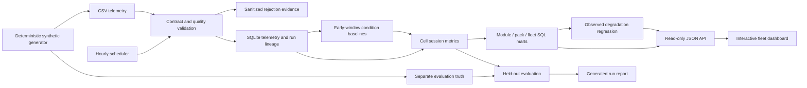

# Technical Architecture

## Data flow

## Warehouse design

| Layer | Objects | Grain and ownership |
| --- | --- | --- |
| Lineage | ingestion_runs | SHA-256 file digest, acceptance counts, processing UTC time |
| Quality | quality_issues | File digest + CSV row number; sanitized reason, no raw payload |
| Samples | telemetry | Pack + module + cell + day + step; immutable primary key |
| Cell analytics | cell_metrics | One discharge session per cell/day |
| Hierarchy | module_daily, pack_daily, fleet_daily | SQL aggregates; pack and fleet weighting documented |
| Trends | degradation | One observed-window regression per pack |
| Coverage | quality_summary | Expected 12-cell coverage and scoring eligibility per observed pack/day |

SQLite WAL allows concurrent API readers and a batch writer. The API uses
read-only connections and a resource allowlist. Query limits bound response size.
The `day,pack` telemetry index supports chronological queries.

Each CSV transaction includes accepted rows, rejected-row evidence, analytical
recomputation and the ingestion-run record. An exception rolls everything back.
Reprocessing the same bytes is a no-op. Identical sample keys across files are
counted as duplicates; changed values at an existing key are quarantined. One
scheduler instance is supported. SQLite lock timeouts are surfaced for retry.

The transforms recompute the demo warehouse after each new file. This is simple
and reproducible for 35,640 rows. Large fleets need partitioned incremental models,
bounded ingestion memory, migrations and a warehouse such as PostgreSQL or DuckDB
with an appropriate writer strategy. The current schema is version 1; evolution
requires explicit migrations rather than relying on CREATE IF NOT EXISTS.

## Processing schedule

`python -m fleet schedule --interval 3600` uses an interruptible wait after every
batch. Files are processed in sorted order; already completed file hashes are
skipped. A failed file aborts the current batch and logs a traceback; the next tick
retries. A malformed persistent file must be corrected or removed from the input
directory before later files can progress. Publish new files with an atomic rename
after writing them completely. A restart reruns the scan safely.

The demonstration does not manufacture new future data on every tick. Its fixed
dataset makes results reproducible. New synthetic CSVs can be placed in the input
directory to demonstrate subsequent processing.

## Deployment and operations

Compose provides an init job, API, scheduler and named persistent volume. The API
healthcheck requires a readable warehouse and at least one completed ingestion
run. All-rejected runs remain visible in quality evidence; health indicates service
readiness, not scientific data validity. Operators should also inspect rejection
counts and quality_summary before using metrics.

Back up an active SQLite warehouse with the SQLite backup API, not a raw copy of
the main file while WAL writes are active. Keep generated CSVs and manifests to
rebuild the demo. Stop the writer before replacing the warehouse. There are no
credentials or external data integrations in this project.

## Confidentiality boundary

The source, simulation parameters and anomaly rules were created for this demo.
Only synthetic IDs are accepted by the data contract. This restriction is a guard
against accidental mixing, not a general-purpose data anonymizer. Do not rename
real assets to synthetic IDs and assume that their measurements are public-safe.
Input CSVs and databases stay out of Git. Truth labels are inaccessible to the
analytics model and used only in the offline evaluation script.

